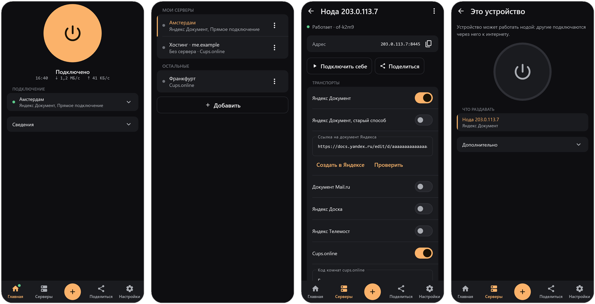
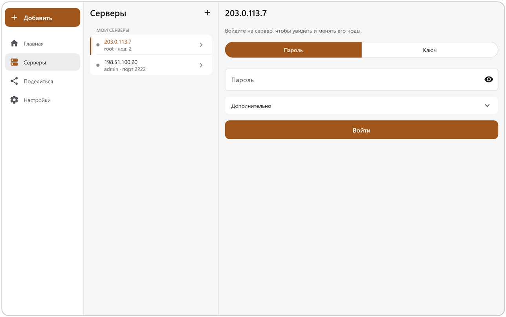

<p align="center">
  
</p>

<h1 align="center">OpenFluxAndroid</h1>

<p align="center">
  Клиент OpenFlux для Android.<br>
  Туннель поверх обычных веб-сервисов с автоматическим переключением между ними.
</p>

<p align="center">
  <a href="../../releases/latest"></a>
  <a href="LICENSE"></a>
  
</p>

<p align="center">
  <a href="README.md">English</a> · <b>Русский</b>
</p>

<p align="center">
  <a href="https://github.com/p1neappleXpress/OpenFlux">Core</a> · <a href="https://github.com/p1neappleXpress/OpenFluxDesktop">Desktop</a> · <a href="https://github.com/p1neappleXpress/OpenFluxAndroid">Android</a> · <a href="https://testflight.apple.com/join/BwnAcdus">iOS (TestFlight, скоро в App Store)</a>
</p>

<p align="center">
  
</p>

## Что это

OpenFluxAndroid — приложение для Android на базе [OpenFlux](https://github.com/p1neappleXpress/OpenFlux). Ядро встроено в APK и работает внутри приложения. Трафик идёт через **транспорт**: документ на веб-сервисе (Яндекс, Mail.ru, cups.online, Avito, Телемост, MAX) или обычное TCP-соединение с вашей нодой. В профиле может быть несколько транспортов; когда один перестаёт работать, приложение переходит на следующий по приоритету.

## Возможности

- **Системный VPN или локальный SOCKS5-прокси.** VPN несёт весь телефон; прокси — для приложений, которые вы направляете на него сами.
- **Несколько транспортов в одном профиле**, у каждого свой приоритет и сеть, по которой ему можно ходить (мобильная или Wi-Fi).
- **Шифрование.** AES-256-GCM от края до края с вашим ключом: сервис, который несёт трафик, его не видит.
- **Нода в несколько касаний.** Мастер ставит выходную ноду на ваш сервер по SSH или на обычный PHP-хостинг, вообще без сервера. Нода обновляется сама и откатывается, если обновление не запустилось.
- **Поделиться ссылкой или QR.** Ссылка `openflux://` несёт весь профиль; камера считывает её обратно.
- **Встроенный браузер** для проверок, которые просят некоторые сервисы (SmartCaptcha, вход в аккаунт).
- **Этот телефон как нода**, чтобы другие устройства подключались через него.
- **Плитка быстрых настроек**, чтобы подключаться и отключаться, не открывая приложение.
- **Обновления из релизов GitHub** со сверкой по `SHA256SUMS.txt`; ставятся только с вашего согласия.

## Установка

Скачайте APK на [странице релизов](../../releases/latest): универсальный или под ваш процессор (`arm64-v8a` для большинства телефонов, `armeabi-v7a` для старых, `x86` и `x86_64` для эмуляторов). Разрешите установку из браузера или файлового менеджера, которым вы скачали файл.

## Сборка из исходников

Нужны JDK 17, Go, Android SDK с NDK 27 и `gomobile` (`go install golang.org/x/mobile/cmd/gomobile@latest`).

```bash
git clone --recurse-submodules https://github.com/p1neappleXpress/OpenFluxAndroid.git
cd OpenFluxAndroid
scripts/build-android-core.sh          # собирает androidApp/libs/openflux.aar из сабмодуля OpenFlux/
./gradlew :androidApp:assembleDebug    # APK, по одному на ABI
```

Клонировали без `--recurse-submodules`? Выполните `git submodule update --init --recursive`. `scripts/build-android-core.sh ../OpenFlux` собирает по отдельной копии ядра вместо сабмодуля. Пересобирайте AAR при каждом изменении Go API ядра или сабмодуля `OpenFlux/`.

## Устройство

```
androidApp/   Сервис VPN, проверка через WebView, камера (QR), настройки
shared/       Сабмодуль: модели, интерфейсы сервисов, дизайн-система, экраны
OpenFlux/     Сабмодуль: ядро (CLI и мост mobile/ для gomobile)
scripts/      build-android-core.sh
```

Те же экраны работают на компьютере в [OpenFluxDesktop](https://github.com/p1neappleXpress/OpenFluxDesktop); оба приложения используют модуль [OpenFluxClientShared](https://github.com/p1neappleXpress/OpenFluxClientShared).

<p align="center">
  
</p>

## Авторы

- **[meepo161](https://github.com/meepo161)** — автор [OpenFluxClient](https://github.com/meepo161/OpenFluxClient), источника интерфейса и логики приложения (`androidApp/`, `shared/`): сессии с несколькими транспортами и переключением, шифрование, проверки во встроенном браузере, мастер ноды и дизайн-система на Compose. Спасибо!
- **[p1neappleXpress](https://github.com/p1neappleXpress)** — автор ядра [OpenFlux](https://github.com/p1neappleXpress/OpenFlux), которое приложение встраивает: туннель, транспорты и протокол согласования.

Прежнее простое приложение с одним транспортом, жившее в этом репозитории, сохранено под тегом [`legacy-native-app`](../../tree/legacy-native-app).

## Лицензия

GNU General Public License v3.0 или новее — см. [LICENSE](LICENSE).
